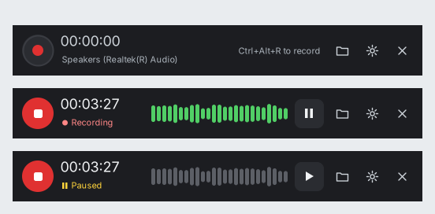

# Mini Recorder

A tiny, always-on-top Windows app that records whatever your computer is playing (system audio) to MP3 or WAV, controlled with global keyboard shortcuts.

## Features

- Records the default playback device (speakers/headphones) using WASAPI loopback. The microphone is not included.
- Floating bar you can drag anywhere. It stays on top of other windows and hides to the system tray.
- Live level meter, pause/resume, and a one-click button to open the recordings folder.
- Saves to MP3 (128/192/320 kbps) with Windows' built-in encoder, or to lossless WAV.
- Quiet stretches are recorded as real silence, so timing stays accurate.
- No install or dependencies. It runs on the .NET Framework 4 that ships with Windows 10 and 11.

## Keyboard shortcuts

These work anywhere in Windows, even when the bar is hidden:

| Shortcut | Action |
|---|---|
| `Ctrl+Alt+R` | Start / stop recording |
| `Ctrl+Alt+P` | Pause / resume |
| `Ctrl+Alt+O` | Open recordings folder |
| `Ctrl+Alt+H` | Show / hide the bar |

When the bar is focused: `Space` starts/stops, `Esc` hides it to the tray.

## Download

Grab `MiniRecorder.zip` from [Releases](../../releases), unzip it, and run `MiniRecorder.exe`.
The exe isn't code-signed, so on first launch Windows may say "Windows protected your PC". Click **More info → Run anyway**.

## Build from source

Run `build.bat`. It uses the C# compiler that comes with Windows
(`%WINDIR%\Microsoft.NET\Framework64\v4.0.30319\csc.exe`), so nothing extra needs to be installed. The output is `MiniRecorder.exe` in the same folder.

## Where things go

- Recordings: `Music\Recordings\Recording YYYY-MM-DD HH-MM-SS.mp3` (changeable in the gear menu)
- Settings: `%APPDATA%\MiniRecorder\settings.ini`

## Notes

- MP3 needs Windows' Media Foundation encoder. On "N" editions without the Media Feature Pack, or when the audio device runs at 96/192 kHz, the recording is kept as WAV and you get a notification.
- WAV files are capped at 4 GB (about 6 hours of audio).

## Project layout

| File | Purpose |
|---|---|
| `src/MiniBar.cs` | The floating bar UI, tray icon, menus, global hotkeys |
| `src/AudioEngine.cs` | WASAPI loopback capture → 16-bit stereo WAV |
| `src/Mp3Converter.cs` | WAV → MP3 via Media Foundation |
| `src/Native.cs` | Win32, Core Audio and Media Foundation interop |
| `src/Settings.cs` | Settings file |
| `src/Program.cs` | Entry point, single-instance guard |
